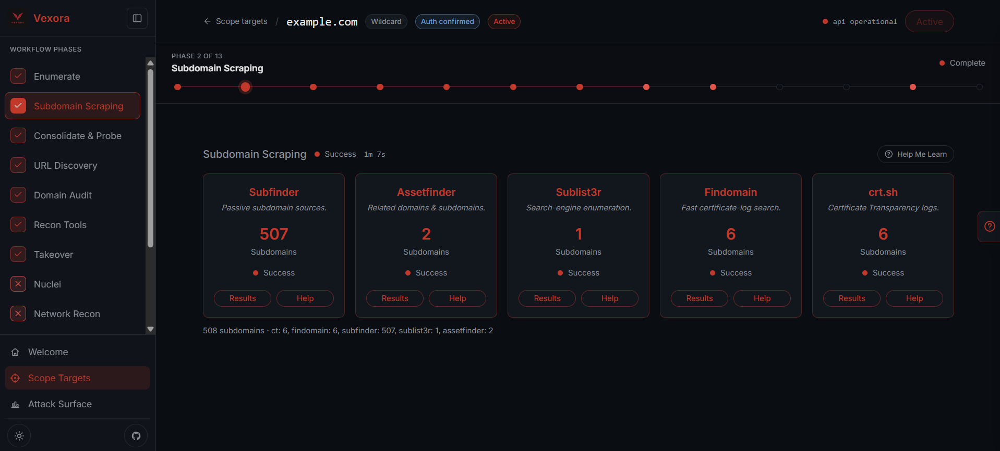

<p align="center">
  
</p>

<h1 align="center">Vexora</h1>

<p align="center">
  <strong>AI-native attack-surface reconnaissance &amp; bug-bounty framework.</strong><br />
  Self-hosted. Docker-based. Methodology-enforcing. Agent-controllable.
</p>

<p align="center">
  
  
  
  
  
  
  
</p>

<p align="center">
  
</p>

---

## Table of contents

- [What is Vexora?](#what-is-vexora)
- [Why use Vexora?](#why-use-vexora)
- [Feature highlights](#feature-highlights)
- [Architecture](#architecture)
- [Tech stack & dependencies](#tech-stack--dependencies)
- [System requirements](#system-requirements)
- [Installation (from scratch)](#installation-from-scratch)
- [Configuration reference](#configuration-reference)
- [Included tools](#included-tools)
- [Workflows & scans](#workflows--scans)
- [REST API reference](#rest-api-reference)
- [MCP server (AI-agent control plane)](#mcp-server-ai-agent-control-plane)
- [Project structure](#project-structure)
- [Local development](#local-development)
- [Updating](#updating)
- [Guardrails & authorized use](#guardrails--authorized-use)
- [Roadmap / status](#roadmap--status)
- [Author & contact](#author--contact)
- [License](#license)

---

## What is Vexora?

**Vexora** is a self-hosted web application that wraps a large suite of open-source
security tools behind a single UI and REST API. Instead of running recon tools ad hoc
and juggling scattered output files, Vexora drives a correct bug-bounty methodology —
**recon → enumeration → prioritization → manual testing** — and stores every result as
structured, queryable data.

It is built on three pillars:

- **Human judgment** — Vexora surfaces data and ranks targets; it never decides for you.
- **AI agents** — an **MCP server** lets a coding/security agent (Claude Code, Cursor,
  Claude Desktop, …) drive the framework through the same REST API a human uses.
- **Automated tools** — repetitive, high-volume work (subdomain enum, live probing,
  crawling, screenshots) runs in isolated per-tool Docker containers.

> **Authorized testing only.** Vexora refuses to activate a scope target for scanning
> until you explicitly acknowledge authorization. See
> [Guardrails & authorized use](#guardrails--authorized-use).

---

## Why use Vexora?

Running `subfinder | httpx | nuclei` by hand is fast for one target, but it falls apart
at bug-bounty scale: output is unstructured, results are not reproducible, and there is
no single place to see *what you have* versus *what to do next*.

Vexora solves that:

| Problem without a framework | How Vexora fixes it |
| --- | --- |
| Tool output is unstructured text scattered across terminals/files | Every tool's output is parsed into typed Postgres rows and browsable in the UI |
| No prioritization — you guess where to start | Live servers are ranked (ROI) so you test the best targets first |
| Tools are hard to reproduce / version | Each scan runs in a pinned Docker image; raw stdout/stderr is retained per job |
| You forget a step or run tools in the wrong order | Guided workflows enforce methodology and show live per-step progress |
| No audit trail when testing real infrastructure | Every scan job, step, and target is stored in Postgres |
| AI agents can't operate your recon stack | The MCP server exposes the same capabilities an agent can call |
| Setup is painful | `docker compose up` after a one-time image build |

**In short:** Vexora is the difference between *having tools* and *having a repeatable,
prioritized, auditable workflow*.

---

## Feature highlights

- **Scope targets** — `company`, `wildcard`, and `url` types, each with an explicit
  authorization gate and notes.
- **Guided workflows**
  - **Wildcard workflow** — subdomain enumeration → parallel scraping → consolidate &
    live-server probe → URL discovery (4 steps).
  - **Domain audit workflow** — DNS/DNSSEC, email security (SPF/DKIM/DMARC), HTTP
    security headers/CSP, and TLS configuration (4 steps).
- **Ad-hoc tool scans** — run any of 16 tools directly against an active scope target.
- **Live-server discovery & screenshots** — httpx probes plus fully-rendered PNG
  screenshots viewable inline in the UI.
- **Subdomain takeover detection**, **Nuclei vulnerability scanning**, **network recon**
  (resolve → port scan → service fingerprint), **SQL injection testing**, **JavaScript
  secrets/endpoint extraction**, and **open-redirect testing**.
- **Raw output viewer** — inspect the exact stdout/stderr of any scan job for trust and
  debugging.
- **Attack-surface dashboard** — targets by type, ROI leaderboard, and searchable tables.
- **MCP server** — agent access to the API over SSE.
- **Responsive UI** with **dark & light themes**.

---

## Architecture

```
                        ┌──────────────────────────────┐
   Browser  ──────────► │        nginx (:80)           │
                        └──────────────┬───────────────┘
                                       │
              ┌────────────────────────┼─────────────────────────┐
              │                        │                         │
       /*     ▼                 /api/* ▼                  /mcp/* ▼
   ┌──────────────────┐   ┌──────────────────┐      ┌────────────────┐
   │ client (React)   │   │ api (Go)         │◄─────│ mcp-server     │
   │ static SPA       │   │ REST /api/v1     │      │ (Node, SSE)    │
   └──────────────────┘   └───────┬──────────┘      └────────────────┘
                                  │
                         ┌────────┴─────────┐
                         ▼                  ▼
                  ┌────────────┐     ┌──────────────────────────────┐
                  │ Postgres   │     │ worker (Go)                  │
                  │ (metadata) │     │  └► per-tool Docker container│
                  └────────────┘     │     (subfinder, httpx, …)    │
                                     └──────────────────────────────┘
```

- **nginx** is the single exposed port and reverse-proxies to the client, API, and MCP
  server.
- **api** is the single source of truth; both the React UI and the MCP server call it.
- **worker** claims queued scan jobs from Postgres, then launches one short-lived
  container per tool (via the host Docker socket) and parses the output back into the DB.
- **Postgres** stores all structured data; raw tool output and screenshots live in a
  shared Docker volume.

---

## Tech stack & dependencies

### Backend (`api/`) — Go 1.22

| Dependency | Version | Purpose |
| --- | --- | --- |
| [`go-chi/chi`](https://github.com/go-chi/chi) | v5.1.0 | HTTP router + middleware |
| [`jackc/pgx`](https://github.com/jackc/pgx) | v5.6.0 | PostgreSQL driver & connection pool |
| [`google/uuid`](https://github.com/google/uuid) | v1.6.0 | UUID handling |
| `golang.org/x/crypto`, `golang.org/x/sync`, `golang.org/x/text` | indirect | pgx dependencies |

Migrations are plain SQL files embedded with `//go:embed` and applied automatically on
API startup (`api/migrations/*.sql`, tracked in a `schema_migrations` table).

### Frontend (`client/`) — Node 20 / TypeScript 5

| Dependency | Version | Purpose |
| --- | --- | --- |
| [`react`](https://react.dev) + `react-dom` | ^18.3.1 | UI |
| [`react-router-dom`](https://reactrouter.com) | ^6.26.1 | Routing |
| [`@tanstack/react-query`](https://tanstack.com/query) | ^5.51.23 | Data fetching & caching |
| [`recharts`](https://recharts.org) | ^2.12.7 | Charts |
| [`vite`](https://vitejs.dev) | ^5.4.2 | Dev server & build |
| [`tailwindcss`](https://tailwindcss.com) | ^3.4.10 | Styling |
| `typescript` | ^5.5.4 | Type safety |

### MCP server (`mcp-server/`) — Node 20

| Dependency | Version | Purpose |
| --- | --- | --- |
| [`@modelcontextprotocol/sdk`](https://github.com/modelcontextprotocol/sdk) | ^1.0.4 | MCP protocol (SSE transport) |
| [`express`](https://expressjs.com) | ^4.19.2 | HTTP server |
| [`zod`](https://zod.dev) | ^3.23.8 | Tool input validation |

### Infrastructure & data

| Component | Image / version | Role |
| --- | --- | --- |
| PostgreSQL | `postgres:16-alpine` | Primary datastore |
| nginx | `nginx:1.27-alpine` | Reverse proxy (port 80) |
| Docker Compose | v2 | Orchestration (6 services + tool images) |

---

## System requirements

- **Docker Desktop** (Windows/macOS) or **Docker Engine + Compose v2** (Linux)
- **Git**
- **8 GB+ RAM recommended** (many concurrent tool containers)
- ~5 GB free disk for images
- On Windows: WSL2 backend enabled for Docker Desktop

> Go 1.22+ and Node 20+ are only needed if you want to run the API/client **outside**
> Docker for development. A normal install needs only Docker + Git.

---

## Installation (from scratch)

### 1. Install prerequisites

- Windows/macOS: [Docker Desktop](https://www.docker.com/products/docker-desktop/)
- Linux: Docker Engine + the `docker compose` plugin
- [Git](https://git-scm.com/downloads)

Verify:

```bash
docker --version
docker compose version
git --version
```

### 2. Clone the repository

```bash
git clone https://github.com/spondonsaha/vexora.git
cd vexora
```

### 3. Create your environment file

The repo ships `.env.example` (safe placeholders); the real `.env` is **gitignored**.

**Windows (PowerShell):**

```powershell
Copy-Item .env.example .env
```

**Linux / macOS:**

```bash
cp .env.example .env
```

Then edit `.env` and change at least the database password — the defaults are
placeholders and must **not** be used on a reachable host:

```env
POSTGRES_USER=recon
POSTGRES_PASSWORD=change_me_in_production      # <-- change this
POSTGRES_DB=recon
DATABASE_URL=postgres://recon:change_me_in_production@db:5432/recon?sslmode=disable
```

> Keep `@db:5432` in `DATABASE_URL` — that hostname resolves inside the Compose network.

### 4. Build the self-hosted tool images (first run only)

Several tools have no reliable public image, so they are built locally. This is the slow
step on a first install.

**Windows:**

```powershell
.\build-tools.ps1
```

**Linux / macOS:**

```bash
./build-tools.sh
```

### 5. Build the application services

```bash
docker compose build api worker client mcp-server
```

> Important: build tool images **sequentially** (the provided scripts do this). Parallel
> builds of many source‑compiled tools often race on Docker's image store.

### 6. Start the stack

```bash
docker compose up -d
```

Database migrations run automatically when the API starts.

### 7. Open the app

- **Web UI:** <http://localhost>
- **API health:** <http://localhost/api/v1/health>
- **MCP health:** <http://localhost/mcp/health>

Create a scope target, tick the authorization box, activate it, and run a workflow.

### One-shot alternative

On Windows, `build.ps1` builds the tool images **and** all services in the correct order:

```powershell
.\build.ps1
docker compose up -d
```

---

## Configuration reference

All settings are environment variables (see `.env.example`). Key ones:

### Runtime & database

| Variable | Default | Description |
| --- | --- | --- |
| `POSTGRES_USER` / `POSTGRES_PASSWORD` / `POSTGRES_DB` | `recon` | Postgres credentials |
| `DATABASE_URL` | `postgres://recon:…@db:5432/recon?sslmode=disable` | API/worker DSN |
| `API_PORT` | `8080` | API listen port (internal) |
| `API_ENV` | `development` | Environment label |
| `CORS_ALLOWED_ORIGINS` | `http://localhost:5173,http://localhost` | Allowed CORS origins |

### Guardrails

| Variable | Default | Description |
| --- | --- | --- |
| `DEFAULT_RATE_LIMIT_RPS` | `10` | Outbound request rate cap |
| `DEFAULT_TOOL_TIMEOUT_SECONDS` | `300` | Per-tool timeout |
| `WORKER_POLL_SECONDS` | `3` | Job queue poll interval |
| `WORKFLOW_MAX_CONCURRENCY` | `3` | Max parallel containers in a workflow step |

### Per-tool enable toggles

`SUBFINDER_ENABLED`, `ASSETFINDER_ENABLED`, `SUBLIST3R_ENABLED`, `FINDOMAIN_ENABLED`,
`CT_ENABLED`, `GAU_ENABLED`, `WAYBACKURLS_ENABLED`, `KATANA_ENABLED`, `TAKEOVER_ENABLED`,
`NUCLEI_ENABLED`, `NETWORK_SCAN_ENABLED`, `SQLI_ENABLED`, `JSRECON_ENABLED`,
`OPENREDIRECT_ENABLED`, `AMASS_ENABLED` (all default `true`).

### Tool image overrides

`SUBFINDER_IMAGE`, `AMASS_IMAGE`, `GAU_IMAGE`, `HTTPX_IMAGE`, `ASSETFINDER_IMAGE`,
`SUBLIST3R_IMAGE`, `FINDOMAIN_IMAGE`, `CT_IMAGE`, `WAYBACKURLS_IMAGE`, `KATANA_IMAGE`,
`DOMAIN_AUDIT_IMAGE`, `TAKEOVER_IMAGE`, `NUCLEI_IMAGE`, `SQLMAP_IMAGE`, `JSRECON_IMAGE`,
`OPENREDIRECT_IMAGE`, `DNSX_IMAGE`, `NAABU_IMAGE`, `NMAP_IMAGE`.

### Scan caps

| Variable | Default | Description |
| --- | --- | --- |
| `NETWORK_MAX_HOSTS` | `5000` | Max hosts resolved per network scan |
| `SQLI_MAX_TARGETS` | `10` | Max URLs tested per SQLi run |
| `JSRECON_MAX_FILES` | `100` | Max JS files fetched per run |
| `OPENREDIRECT_MAX_TARGETS` | `50` | Max URLs tested per open-redirect run |
| `OPENREDIRECT_CANARY` | `evil.com` | Canary host for redirect checks |
| `AMASS_ACTIVE` | `true` | Whether Amass runs in active mode |

### MCP server

| Variable | Default | Description |
| --- | --- | --- |
| `MCP_PORT` | `3001` | MCP listen port (internal) |
| `MCP_AUTH_TOKEN` | *(empty)* | Optional bearer token; if set, clients must send `Authorization: Bearer <token>` |

---

## Included tools

Vexora wraps the following tools. Public images are pulled automatically; `recon/*`
images are built locally from `tools/`.

| Tool | Image | What it does |
| --- | --- | --- |
| **Amass** | `caffix/amass:latest` | Attack-surface / subdomain enumeration |
| **Subfinder** | `projectdiscovery/subfinder:latest` | Passive subdomain enumeration |
| **Assetfinder** | `recon/assetfinder:latest` | Find related domains/subdomains |
| **Sublist3r** | `recon/sublist3r:latest` | Subdomain enumeration |
| **Findomain** | `recon/findomain:latest` | Cross-platform subdomain enumeration |
| **crt.sh (CT)** | `recon/ct:latest` | Certificate Transparency lookups |
| **GAU** | `sxcurity/gau:latest` | Fetch known URLs from public archives |
| **waybackurls** | `recon/waybackurls:latest` | Fetch Wayback Machine URLs |
| **Katana** | `projectdiscovery/katana:latest` | Web crawling (JS-aware) |
| **httpx** | `projectdiscovery/httpx:latest` | HTTP probing, tech detection & screenshots |
| **Domain audit** | `recon/domainaudit:latest` | DNS/DNSSEC, SPF/DKIM/DMARC, headers, TLS |
| **Subdomain takeover** | `recon/takeover:latest` | Fingerprint dangling CNAMEs / takeovers |
| **Nuclei** | `recon/nuclei:latest` | Template-based vulnerability scanning |
| **sqlmap** | `recon/sqlmap:latest` | SQL injection detection |
| **JS recon** | `recon/jsrecon:latest` | Extract secrets/endpoints from JavaScript |
| **Open redirect** | `recon/openredirect:latest` | Open-redirect / header-injection probing |
| **dnsx** | `projectdiscovery/dnsx:latest` | Fast DNS resolution / reverse DNS |
| **naabu** | `projectdiscovery/naabu:latest` | Port scanning |
| **nmap** | `instrumentisto/nmap:latest` | Service / version fingerprinting |

---

## Workflows & scans

### Wildcard workflow (4 steps)

1. **Enumeration (Amass)** — maps the target's DNS footprint from passive/active sources.
2. **Subdomain scraping (parallel)** — Subfinder, Assetfinder, Sublist3r, Findomain and
   crt.sh run concurrently; results are merged and deduplicated.
3. **Consolidate + live-server probe** — dedupe, then httpx reports which hosts are live,
   along with status code, title, tech stack, headers and a screenshot.
4. **URL discovery (parallel)** — GAU, waybackurls and Katana pull historical/archived/
   crawled URLs; endpoints with parameters or interesting extensions are flagged.

### Domain audit workflow (4 steps)

1. **DNS records & DNSSEC** — NS/MX/SOA/CAA/TXT, DNSSEC signing, wildcard, AXFR attempt.
2. **Email security** — SPF, DMARC, DKIM, MTA-STS, TLS-RPT.
3. **HTTP security headers & CSP** — HSTS, CSP, X-Frame-Options, cookie flags, etc.
4. **TLS configuration** — protocol/cipher negotiation, certificate issuer/expiry,
   legacy TLS 1.0/1.1, modern TLS 1.2/1.3.

### Ad-hoc scans

Run directly against an active scope target: `subfinder`, `amass`, `assetfinder`,
`sublist3r`, `findomain`, `ct`, `gau`, `waybackurls`, `katana`, `takeover`, `nuclei`,
`netscan` (dnsx + naabu + nmap), `sqli`, `jsrecon`, `openredirect`, and `screenshot`.

---

## REST API reference

Base path: `/api/v1`.

| Method | Path | Description |
| --- | --- | --- |
| `GET` | `/health` | API + DB health |
| `GET` / `POST` | `/scope-targets` | List / create scope targets |
| `GET` / `DELETE` | `/scope-targets/{id}` | Get / delete a target |
| `PATCH` | `/scope-targets/{id}/activate` | Activate for scanning (requires authorization) |
| `PATCH` | `/scope-targets/{id}/notes` | Update notes |
| `GET` | `/scans` | List scan jobs |
| `POST` | `/scans/{tool}` | Start an ad-hoc scan (body: `scope_target_id`, `options`) |
| `GET` | `/scans/{id}` | Scan status |
| `GET` | `/scans/{id}/raw-output` | Raw stdout/stderr |
| `GET` | `/workflows` | List workflow runs |
| `POST` | `/workflows/wildcard/run` | Start the wildcard workflow |
| `POST` | `/workflows/domain/run` | Start the domain audit workflow |
| `GET` | `/workflows/{id}` | Workflow + per-step status |
| `GET` | `/targets/{id}/subdomains` | Subdomains for a target |
| `GET` | `/targets/{id}/live-servers` | Live web servers |
| `GET` | `/targets/{id}/endpoints` | Discovered endpoints |
| `GET` | `/targets/{id}/nuclei-findings` | Nuclei findings |
| `GET` | `/targets/{id}/network-services` | Network services |
| `GET` | `/targets/{id}/sqli-findings` | SQLi findings |
| `GET` | `/targets/{id}/js-findings` | JS findings |
| `GET` | `/targets/{id}/open-redirect-findings` | Open-redirect findings |
| `GET` | `/live-servers/{id}/screenshot` | Screenshot PNG for a live server |

---

## MCP server (AI-agent control plane)

The MCP server exposes Vexora's capabilities over **SSE** so an agent can operate the
framework. It proxies to the same REST API — no duplicated logic.

- **SSE endpoint:** `http://localhost/mcp/sse`
- **Health:** `http://localhost/mcp/health` → reports `{ service, tools }`
- **Auth:** optional bearer token via `MCP_AUTH_TOKEN` (`Authorization: Bearer <token>`)

Currently exposed tools (6): `health`, `list_scope_targets`, `get_scope_target`,
`create_scope_target`, `activate_scope_target`, `delete_scope_target`. The tool surface
mirrors the REST API and is designed to grow to cover scans, workflows and findings.

> An unauthenticated MCP server on a reachable port can run scans or delete data — set
> `MCP_AUTH_TOKEN` before exposing it beyond localhost.

---

## Project structure

```
vexora/
├── assets/                      # README/brand assets (logo)
├── api/                         # Go backend (module: github.com/spondonsaha/vexora/api)
│   ├── cmd/
│   │   ├── api/                 # HTTP API entrypoint
│   │   └── worker/              # job-queue worker entrypoint
│   ├── internal/
│   │   ├── api/                 # handlers, router, middleware
│   │   ├── config/              # environment configuration
│   │   ├── db/                  # pgx pool + migration runner
│   │   ├── models/              # domain types
│   │   ├── scanner/             # tool runners, parsers, workflows
│   │   └── store/               # Postgres data access (PGStore)
│   ├── migrations/              # embedded SQL migrations (0001–0012)
│   ├── Dockerfile
│   ├── go.mod
│   └── go.sum
├── client/                      # React + Vite SPA
│   ├── public/                  # logo, favicons
│   ├── src/
│   │   ├── components/          # panels, tables, UI primitives
│   │   ├── lib/                 # API client, types
│   │   ├── pages/               # onboarding, targets, detail, dashboard
│   │   └── theme/               # dark/light theme
│   ├── Dockerfile
│   └── package.json
├── mcp-server/                  # MCP server (Node, SSE)
│   ├── src/server.js
│   ├── Dockerfile
│   └── package.json
├── nginx/                       # reverse-proxy config
├── tools/                       # self-built tool images (Dockerfile each)
│   ├── assetfinder/  ct/  domainaudit/  findomain/  jsrecon/  nuclei/
│   ├── openredirect/ sqlmap/ sublist3r/  takeover/  waybackurls/
├── .env.example
├── LICENSE                      # MIT
├── docker-compose.yml           # db, api, worker, client, mcp-server, nginx
├── build.ps1 / build.sh         # build tool images + services (sequential)
├── build-tools.ps1 / .sh        # build only the recon tool images
├── update.ps1 / update.sh       # pull, back up, rebuild, restart
└── Recon Framework Build Spec.md
```

---

## Local development

Run the infrastructure in Docker, but the API and client on your machine for fast
iteration.

```bash
# infra only
docker compose up -d db

# backend (Go 1.22+)
cd api
go build ./...
go run ./cmd/api          # set DATABASE_URL to point at localhost:5432

# frontend (Node 20+) — Vite dev server on :5173, proxies /api to :8080
cd client
npm install
npm run dev
```

Useful commands:

```bash
cd api && go vet ./...                 # static checks
cd client && npm run typecheck         # TypeScript only
cd client && npm run build             # typecheck + production build
```

---

## Updating

The update scripts stop the stack, back up your compose file/`.env`/wordlists, pull the
latest code, rebuild sequentially, and restart (migrations run on API boot):

```powershell
.\update.ps1        # Windows
```
```bash
./update.sh         # Linux / macOS
```

---

## Guardrails & authorized use

Vexora is built so it can only be pointed at assets **you are authorized to test**.

- Every scope target needs an explicit **"I am authorized"** acknowledgment before it
  can be activated for scanning.
- Every outbound tool call is **rate-limited and timed out** by default.
- Vulnerability modules **detect and report**; they do not auto-exploit.
- Every scan job, workflow step and result is recorded in Postgres for auditability.

**Never run Vexora against systems you do not own or lack written permission to test.**

---

## Roadmap / status

**Implemented**

- Postgres schema + migrations (0001–0012)
- Scope-target management with authorization gating
- Wildcard workflow (enum, scrape, consolidate+probe, URLs)
- Domain audit workflow (DNS, email, headers, TLS)
- Live-server probing **with screenshots**
- Ad-hoc scans for 16 tools
- Subdomain takeover, Nuclei, network recon, SQLi, JS recon, open redirect
- Attack-surface dashboard, ROI leaderboard, notes, raw-output viewer
- MCP server (scope-target tools)
- Dark & light themes, responsive layout

**Planned**

- Company workflow (ASN/root-domain discovery → auto-create wildcard targets)
- Import/export bundles
- Settings & per-service API-key management
- Expanded MCP tool surface (scans, workflows, findings)

---

## Author & contact

**Vexora** is built and maintained by **Spondon Saha**.

- LinkedIn: <https://www.linkedin.com/in/spondonsaha/>
- GitHub: <https://github.com/spondonsaha>

Contributions, issues and feature requests are welcome — open an issue or a pull request.

---

## License

Released under the [MIT License](LICENSE).

Copyright (c) 2026 Spondon Saha.
